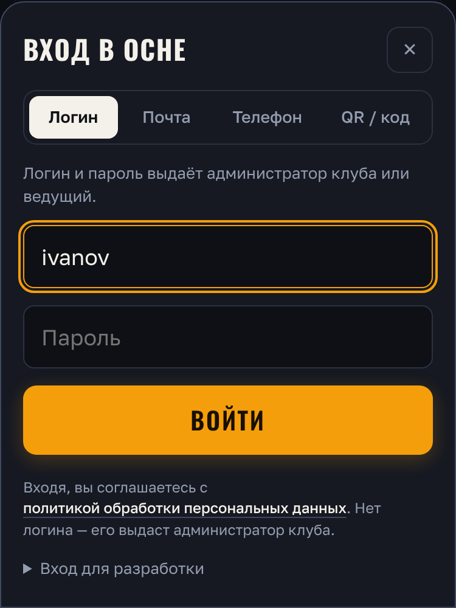
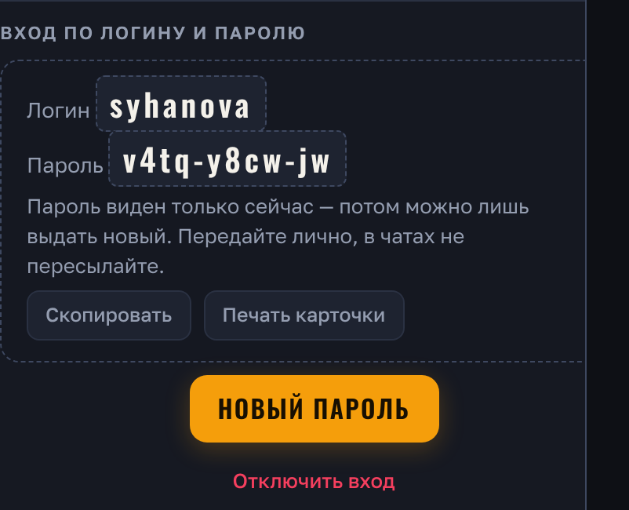
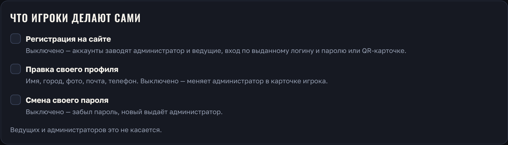
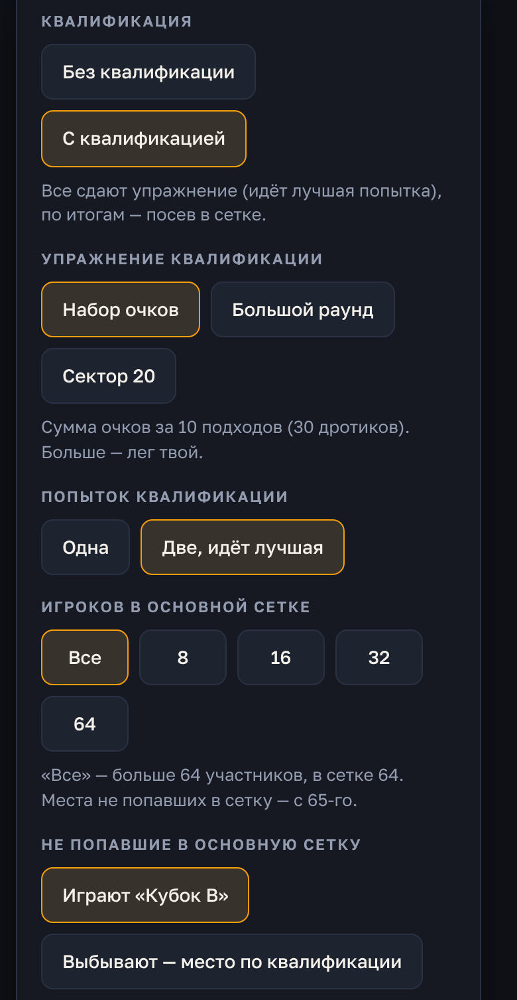
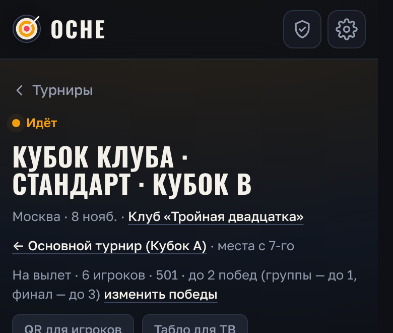
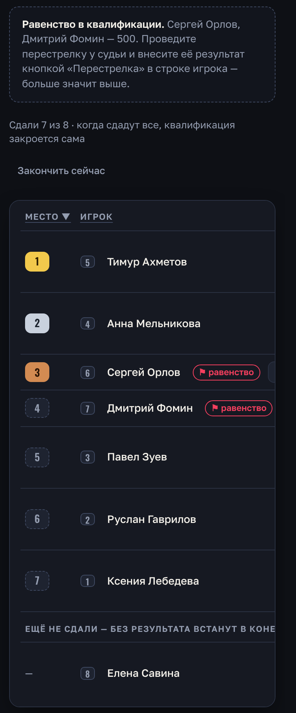
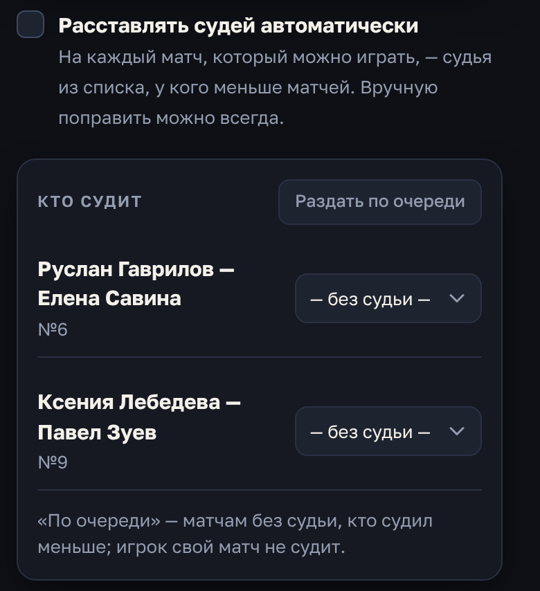
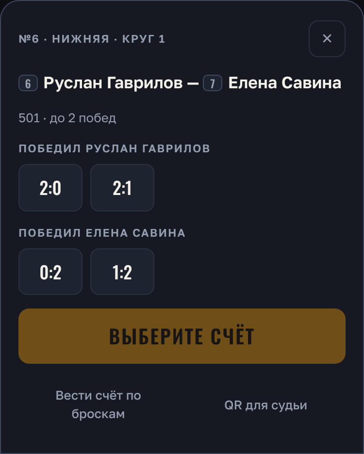
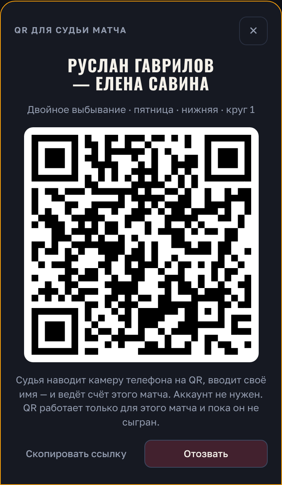
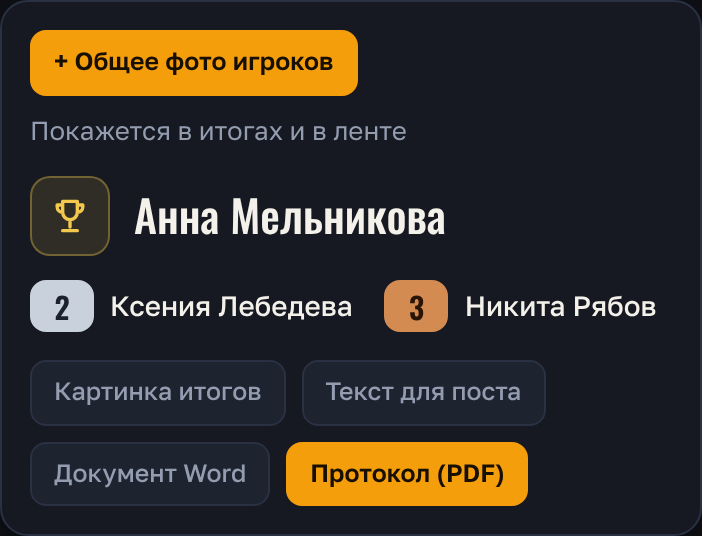

# Инструкция администратору клуба

Короткая инструкция для администратора и ведущих. То же есть в приложении: шестерёнка → «Как пользоваться».

## 1. Вход

- Администратор входит по логину, паролю и коду из Google Authenticator. Войти можно в окне входа (вкладка «Логин») или на странице `https://ДОМЕН/#admin`.
  - При первом входе приложение привязывается по QR-коду.
  - После 5 неверных паролей вход закрывается на 15 минут.
- Панель управления — значок щита вверху.




## 2. Игроки: аккаунт, логин и пароль

По умолчанию регистрация на сайте закрыта: аккаунты заводят администратор и ведущие.

1. **Новый игрок:** «Управление» → «Игроки» → «+ Новый аккаунт» — имя, город, клуб.
2. **Выдать вход** — там же сразу «Выдать логин и пароль».
   - Логин подбирается по фамилии латиницей (`ivanov`, если занят — `ivanov2`).
   - Пароль случайный, вида `ab3k-x7mq-2p`.
   - Пароль виден только один раз. Нажмите «Скопировать» или «Печать карточки»: на карточке логин, пароль и QR, по которому открывается вход с уже подставленным логином.
   - Передайте пароль лично, в чатах не пересылайте.
3. **Без пароля** — QR-карточка: игрок наводит камеру и сразу входит. Удобно для гостей и пожилых игроков.
4. **Забыл пароль:** карточка игрока → «Новый пароль». Старый перестаёт работать, все входы игрока закрываются.
5. **Отключить вход:** карточка игрока → «Отключить вход».

Ведущий выдаёт логин и пароль тем аккаунтам, которые завёл сам. Администратор — любому игроку и ведущему.




## 3. Профиль игрока

Игрок сам свой профиль не меняет (если тех. администратор не разрешил). Всё правит администратор в карточке игрока («Управление» → «Игроки» → игрок):
- имя, город, клуб, звание;
- данные для протокола: ФИО, год рождения, пол, субъект РФ;
- заметки.

В карточке также видно:
- средний набор: по всем матчам и в турнирах;
- число матчей и турниров;
- кто завёл аккаунт;
- последние действия.

Там же — роль, блокировка и удаление.

## 4. Что игроки делают сами (тех. администратор)

«Управление» → «Права ролей» → «Что игроки делают сами»:
- **Регистрация на сайте** — игроки заводят аккаунт сами (почта и пароль);
- **Правка своего профиля** — имя, город, фото, почта, телефон;
- **Смена своего пароля**.

По умолчанию всё выключено. Ведущих и администраторов это не касается. Там же — таблица прав ролей.




## 5. Турнир

1. **Создание:** «Турниры» → «+ Создать турнир». Укажите название, формат, игру (501 и др.) и до скольких побед (1–11).
   - Квалификация — по желанию, к любому формату.
   - Посев, взнос, мишени, вид сетки — в «Дополнительно». По умолчанию всё уже настроено: посев по рейтингу, без взноса.
2. **Участники.** Есть два варианта:
   - выбрать сразу;
   - «Открытая регистрация»: игроки записываются сами, вы задаёте число мест и время начала.

   Ручной посев: «Дополнительно» → «Посев» → «Вручную», порядок стрелками.
3. **Больше 64 игроков.** С квалификацией (или группами) можно до 128.
   - «Игроков в основной сетке» — 8, 16, 32 или 64.
   - Остальные после квалификации сами уходят в «Кубок B» — отдельную сетку со сквозными местами (65-е, 66-е…). Мишени у «Кубка B» те же, что у основного турнира.
   - Не нужен «Кубок B» — «Не попавшие в основную сетку» → «Выбывают»: их места — по итогам квалификации.
   - С группами («Стандарт», «Комплексный») — до 16 групп. «Игроков в основной сетке» там сам подбирает, сколько выходит из каждой группы; не вышедшие — «Кубок B» или заканчивают турнир.
4. **Начать** — «Начать турнир» на странице турнира.






## 6. По ходу турнира — что происходит само

- **Квалификация** закрывается сама, когда все сдали попытки. Строится сетка (или группы).
  - Таблицу можно сортировать по фамилии и результатам.
  - Результат любой попытки вы можете исправить: «Ввести» или нажать на результат.
- **Равенство в квалификации:** в таблице флажок «⚑ равенство» у этих игроков. Проведите перестрелку у судьи и внесите её результат кнопкой «Перестрелка» — больше значит выше. Квалификация закроется сама. «Закончить сейчас» — если нужно раньше.



- **Групповой этап** закрывается сам после последнего матча групп, и сетка строится автоматически.
- **Мишени:** укажите число мишеней (+/−) — игроки распределяются по ним сами, каждый видит, куда идти.
- **«Ваш матч»:** игрок видит свой матч и соперника. Оба нажали «Готов» у мишени — матч начинается.
- **Места, рейтинг, статистика** — считаются сами.

## 7. Счёт и судьи

- **Кто ведёт счёт:**
  - сами игроки со своих телефонов;
  - судья;
  - организатор (кнопка «Счёт» — итог без бросков или «Вести счёт по броскам»).
- **Судьи** — вкладка «Судьи»: главный судья (в протокол) и список судей.
  - Галочка «Расставлять судей автоматически»: на каждый матч, который можно играть, встаёт судья, у которого меньше матчей.
  - Вручную поправить можно всегда.



- **Судья без аккаунта** — «Счёт» у матча → «QR для судьи».
  - Судья наводит камеру, вводит своё имя и ведёт счёт только этого матча.
  - QR действует, пока матч не сыгран.
  - «Новый QR» гасит прежний, «Отозвать» — выключить.
  - Имя судьи попадёт в сетку и в протокол.





- **Нет сети** — подходы сохраняются на телефоне (вверху «не отправлено: N») и уходят сами, когда сеть вернётся. Если матч доигран без сети, телефон показывает итог: «Покажите ведущему» — организатор вносит его кнопкой «Счёт» у матча.
- **Сел телефон или он сломался посреди матча** — счёт уже на сервере (кроме последних подходов без сети). С другого телефона откройте матч и нажмите «Забрать ведение счёта»: счёт продолжится с того же места. Это может игрок матча, судья по QR этого матча или организатор.

## 8. После турнира

В карточке итогов:
- **«Протокол (PDF)»** — по форме для федерации, с главным судьёй и судьями матчей (Печать → «Сохранить как PDF»);
- **«Картинка итогов»** и **«Текст для поста»** — для соцсетей.




## 9. Сервер

- Обновления приходят сами: проверенная нами версия выходит в ветку `release`, сервер забирает её раз в 5 минут.
  - Перед обновлением с изменениями базы сервер делает копию базы.
  - Если новая версия не встала, возвращается прежняя.
- Сервер клуба работает без демо-режима.
- **Резервные копии** — каждую ночь в 3:30, сами: база хранится 14 дней, фото — 3 последние недели (`/var/backups/oche/`). Перед каждым обновлением с изменениями базы — ещё одна копия.
- **Восстановить из копии** (делает тех. администратор по SSH, турнир в это время не идёт):
  ```
  set -a; . /etc/oche.env; set +a
  systemctl stop oche
  pg_restore --clean --if-exists -d "$DATABASE_URL" /var/backups/oche/oche-ДАТА.dump
  tar -xzf /var/backups/oche/uploads-ДАТА.tgz -C /srv/oche
  systemctl start oche
  ```
  Всё, что было после копии, пропадёт — поэтому восстанавливают только при поломке. Проверьте восстановление один раз до первого турнира.
- Настройки сервера (почта, VK, телефон) и команды — в `docs/server.md`.
